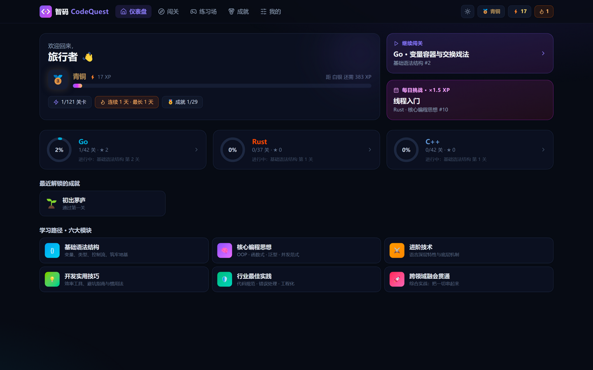
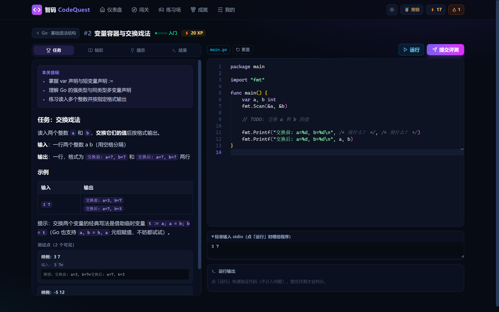
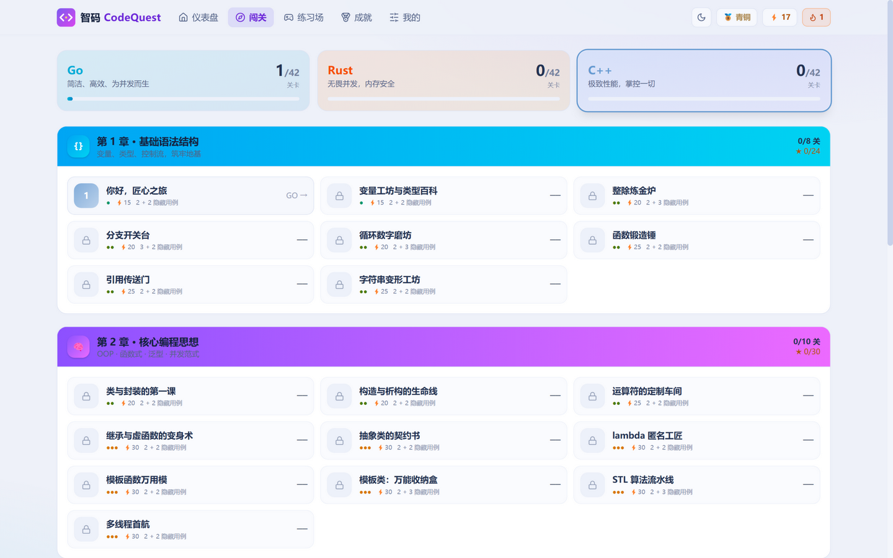
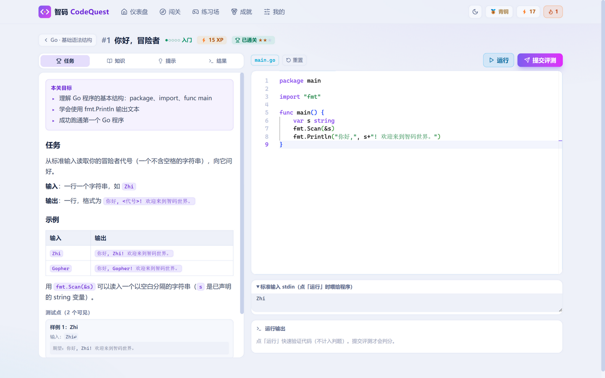

# 智码 CodeQuest 🗡️

游戏化编程闯关学习平台 —— 在浏览器里系统掌握 **Go / Rust / C++**，全程无需本地配置任何开发环境。

 

## 📸 产品预览

| 仪表盘（暗色） | 关卡页（暗色） |
| --- | --- |
|  |  |

| 关卡地图（亮色） | 关卡页（亮色） |
| --- | --- |
|  |  |

> 明暗主题一键切换，全站平滑过渡；关卡地图展示六大模块 × 阶梯解锁。

## ✨ 特性

- **六大模块完整学习路径**（每种语言 42 关，共 126 关）：
  基础语法结构 → 核心编程思想（OOP/函数式/泛型/并发）→ 进阶技术 → 开发实用技巧 → 行业最佳实践 → 跨领域融会贯通
- **术语百科**：264 个核心开发术语覆盖八大领域（**全链路开发** 43 / 前端 41 / 后端 41 / 运维 32 / 嵌入式 28 / AI 28 / 网络工程 27 / Agent 开发 24）。全链路领域提供**从需求 → 原型 → 开发 → 联调 → 测试 → 上线 → 迭代的完整流程视图**；每条术语含精讲、关联关系、代码示例与面试要点，全库搜索 + 关系跳转 + **术语测验模式（得 XP）**
- **真实编译执行**：代码在云端以最新稳定版编译器真实运行 —— Go 1.26 · Rust 1.99 · GCC 16.2 (`-std=c++20`)，Godbolt 主引擎 + Wandbox 自动降级备用
- **自动判题系统**：逐测试点执行、期望/实际输出 diff、隐藏测试点、编译错误定位
- **游戏化系统**：XP 与七大段位（青铜→宗师）、三星评价、章节解锁、每日挑战（×1.5 XP）、连续学习天数、35 个成就
- **明暗主题**：暗色 / 亮色一键切换，全局平滑过渡不闪烁，Monaco 编辑器主题联动，刷新恢复
- **零配置练习**：Monaco 编辑器（本地打包，不依赖 CDN）、自定义 stdin 的自由练习场
- **数据自主**：进度存浏览器 localStorage，支持导出 / 导入 JSON 备份
- **可扩展架构**：新增语言 = 一个 `LanguageDef` 注册 + 章节内容文件，判题/游戏化/页面零改动

## 🚀 快速开始

```bash
npm install
npm run dev        # 打开终端显示的 http://localhost:5173
```

生产构建与本地预览：

```bash
npm run build
npm run preview
```

## ☁️ 在线访问（GitHub Pages）

推送到 `main` 分支后，GitHub Actions（[.github/workflows/deploy.yml](.github/workflows/deploy.yml)）会自动：

1. `npm ci` 安装依赖
2. `tsc -b` 类型检查
3. `vite build --base=/zhiqu/` 构建
4. 发布到 GitHub Pages → **https://cgbin24.github.io/zhiqu/**

首次部署需在仓库 **Settings → Pages** 中把 Source 设为 **GitHub Actions**。

## 🔧 内容验证（维护者）

每关的参考答案都会被脚本真实提交到云端编译执行、逐用例比对：

```bash
node scripts/verify-levels.mjs go/basic        # 只验证某一章
node scripts/verify-levels.mjs --full          # 全部 126 关 + starter 防误过检查
node scripts/verify-terms.mjs                  # 术语数据完整性（关系引用/字段/唯一性）
```

## 🏗️ 架构

```
src/
├── types/            # 全部领域类型
├── data/
│   ├── modules.ts    # 六大模块定义（全语言共用骨架）
│   ├── ranks.ts      # 段位表
│   ├── achievements.ts
│   ├── terms/        # ⭐ 术语百科：七领域数据 + 注册表 + 全库搜索
│   └── languages/
│       ├── registry.ts       # ⭐ 语言注册表（接入新语言的唯一入口之一）
│       └── go|rust|cpp/      # 每语言 6 个章节文件（关卡内容）
├── judge/            # provider 抽象 + Godbolt/Wandbox + 节流队列 + 判题比对
├── game/             # XP / 星级 / 段位 / 术语测验出题引擎
├── store/progress.ts # zustand + localStorage 持久化
├── components/       # 编辑器 / Toast / Diff / 布局 …
└── pages/            # Dashboard / LearnPath / LevelPlay / Terms×4 / Playground / Achievements / Profile
```

### 接入新语言

1. `src/data/languages/registry.ts`：添加 `LanguageDef`（名称、主题色、Monaco id、Godbolt 编译器 id、模板）
2. 新建 `src/data/languages/<lang>/` 六个章节文件，导出 `Level[]`
3. `src/data/languages/index.ts`：把六个数组加入 `CHAPTER_FILES`

判题、游戏化、进度、页面全部自动生效。

## ⚠️ 已知限制

- 判题依赖公共编译服务（Compiler Explorer / Wandbox），离线不可用；高峰期可能排队
- 每日挑战的 ×1.5 XP 每天每关仅一次
- 进度存储于浏览器本地，清除站点数据会丢失（请先在「我的」页导出）
